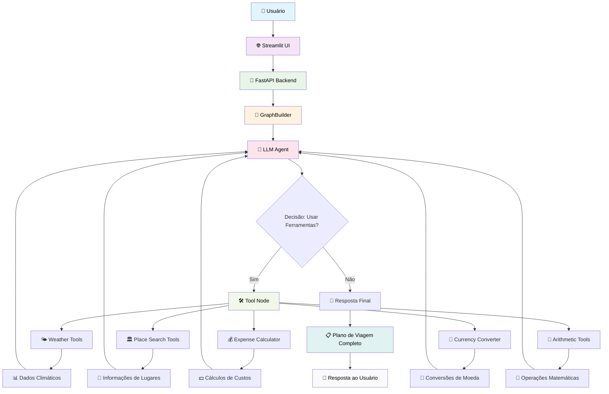
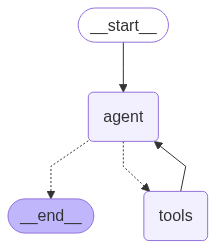

# 🌍 AI Trip Planner - Agentic Agents

Um sistema inteligente de planejamento de viagens baseado em agentes que utiliza múltiplas ferramentas especializadas para criar planos de viagem detalhados e personalizados.

## 🚀 Visão Geral

O AI Trip Planner é uma aplicação que combina a potência dos Large Language Models (LLMs) com ferramentas especializadas para criar planos de viagem abrangentes. O sistema utiliza uma arquitetura de agentes que pode acessar informações em tempo real sobre clima, lugares, restaurantes, atividades e realizar cálculos de despesas.

## 🏗️ Arquitetura

### Componentes Principais

- **FastAPI Backend**: API REST para processamento de consultas
- **Streamlit Frontend**: Interface web amigável para interação
- **LangGraph**: Orquestração de fluxo de trabalho dos agentes
- **Ferramentas Especializadas**: Múltiplas ferramentas para diferentes aspectos do planejamento

### Fluxo de Trabalho


## 🛠️ Ferramentas Utilizadas

O sistema integra várias ferramentas especializadas para fornecer informações completas:

### 🌤️ Weather Info Tool
- **get_current_weather**: Obtém clima atual de uma cidade
- **get_weather_forecast**: Fornece previsão do tempo para uma cidade

### 🏛️ Place Search Tool
- **search_attractions**: Busca atrações turísticas
- **search_restaurants**: Encontra restaurantes recomendados
- **search_activities**: Identifica atividades disponíveis
- **search_transportation**: Informações sobre transporte local

### 💰 Expense Calculator Tool
- **estimate_total_hotel_cost**: Calcula custo total do hotel
- **calculate_total_expense**: Soma todas as despesas da viagem
- **calculate_daily_expense_budget**: Calcula orçamento diário

### 💱 Currency Converter Tool
- **convert_currency**: Converte valores entre diferentes moedas

### 🔢 Arithmetic Operations Tool
- Operações matemáticas básicas para cálculos

## 📊 Gráfico das Ferramentas



*O gráfico acima mostra a interconexão entre as diferentes ferramentas no sistema de agentes.*

## 🚀 Instalação

### Pré-requisitos
- Python 3.12+
- Chaves de API necessárias (veja seção de configuração)

### 1. Clone o repositório
```bash
git clone <repository-url>
cd AI_Trip_Planner
```

### 2. Instale as dependências
```bash
pip install -r requirements.txt
```

### 3. Configure as variáveis de ambiente
Crie um arquivo `.env` na raiz do projeto:

```env
# API Keys necessárias
OPENAI_API_KEY=""
GROQ_API_KEY=""
GOOGLE_API_KEY=""
GPLACES_API_KEY=""
TAVILAY_API_KEY=""
OPENWEATHERMAP_API_KEY=""
EXCHANGE_RATE_API_KEY=""
LANGSMITH_TRACING=
LANGSMITH_ENDPOINT=""
LANGSMITH_API_KEY=""
LANGSMITH_PROJECT=""
```

### 4. Execute a aplicação

#### Backend (FastAPI)
```bash
uvicorn main:app --reload --host 0.0.0.0 --port 8000
```

#### Frontend (Streamlit)
```bash
streamlit run streamlit_app.py
```

## 📖 Como Usar

1. **Acesse a interface**: Abra `http://localhost:8501` no seu navegador
2. **Faça uma pergunta**: Digite sua consulta de viagem (ex: "Planeje uma viagem de 5 dias para Nova York")
3. **Receba o plano**: O sistema irá gerar um plano detalhado incluindo:
   - Itinerário dia a dia
   - Hotéis recomendados com preços
   - Atrações turísticas
   - Restaurantes sugeridos
   - Atividades disponíveis
   - Informações de transporte
   - Quebra de custos detalhada
   - Orçamento diário
   - Informações climáticas

## 🏗️ Estrutura do Projeto

```
AI_Trip_Planner/
├── agent/
│   └── agentic_workflow.py      # Orquestração dos agentes
├── tools/                       # Ferramentas especializadas
│   ├── weather_info_tool.py
│   ├── place_search_tool.py
│   ├── expense_calculator_tool.py
│   ├── currency_conversion_tool.py
│   └── arthamatic_op_tool.py
├── utils/                       # Utilitários
│   ├── weather_info.py
│   ├── place_info_search.py
│   ├── expense_calculator.py
│   ├── currency_converter.py
│   └── model_loader.py
├── prompt_library/              # Prompts do sistema
│   └── prompt.py
├── config/                      # Configurações
├── logger/                      # Sistema de logs
├── exception/                   # Tratamento de exceções
├── main.py                      # API FastAPI
├── streamlit_app.py            # Interface Streamlit
└── requirements.txt            # Dependências
```

## 🔧 Configuração de APIs

### APIs Necessárias

1. **OpenWeatherMap API**: Para informações climáticas
   - Registre-se em: https://openweathermap.org/api
   - Obtenha sua chave de API

2. **Google Places API**: Para informações de lugares
   - Configure no Google Cloud Console
   - Ative Places API

3. **Exchange Rate API**: Para conversão de moedas
   - Registre-se em: https://exchangerate-api.com/

4. **Groq API**: Para processamento de linguagem natural
   - Registre-se em: https://console.groq.com/

5. **Tavily API**: Para busca de informações
   - Registre-se em: https://tavily.com/

## 🎯 Funcionalidades

### ✨ Características Principais

- **Planejamento Inteligente**: Usa IA para criar itinerários personalizados
- **Informações em Tempo Real**: Acesso a dados climáticos e de lugares atualizados
- **Cálculos Automáticos**: Estimativas de custos e conversões de moeda
- **Interface Amigável**: Interface web intuitiva com Streamlit
- **API REST**: Backend robusto com FastAPI
- **Arquitetura Modular**: Fácil extensão e manutenção

### 🔄 Fluxo de Processamento

1. **Entrada do Usuário**: Consulta de viagem via interface web
2. **Processamento do Agente**: Análise da consulta e determinação das ferramentas necessárias
3. **Coleta de Dados**: Uso das ferramentas especializadas para obter informações
4. **Síntese**: Combinação das informações em um plano coeso
5. **Apresentação**: Formatação e entrega do plano final

## 🤝 Contribuição

1. Fork o projeto
2. Crie uma branch para sua feature (`git checkout -b feature/AmazingFeature`)
3. Commit suas mudanças (`git commit -m 'Add some AmazingFeature'`)
4. Push para a branch (`git push origin feature/AmazingFeature`)
5. Abra um Pull Request

## 📝 Licença

Este projeto está sob a licença MIT. Veja o arquivo `LICENSE` para mais detalhes.

